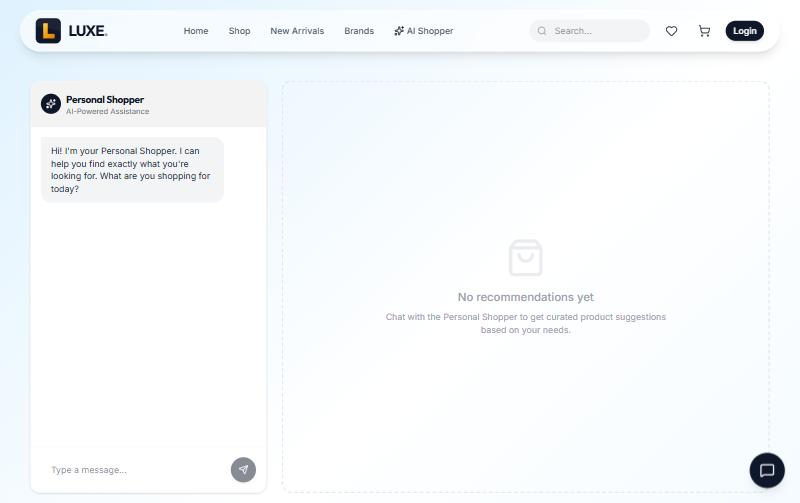
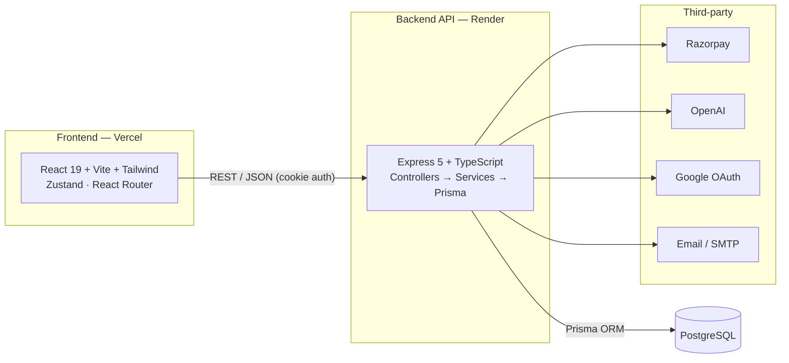

<div align="center">

# 🛍️ LUXE — Full-Stack E-Commerce Platform

A production-style e-commerce application with an AI personal shopper, online payments, Google sign-in, a full admin dashboard, and an advanced PostgreSQL analytics layer.

**[🔗 Live Demo](https://sql-ecommerce-zdgc.vercel.app/)**


</div>

---

## 📸 Screenshots

| Storefront | Product Catalog | AI Personal Shopper |
| :---: | :---: | :---: |
|  |  |  |

---

## ✨ Features

**Storefront**
- Animated landing page with an interactive 3D hero (React Three Fiber) and Framer Motion transitions
- Product catalog with search, category filters, sorting, and product detail pages
- Cart, wishlist, and a multi-step checkout
- Light / dark theme

**Accounts & Auth**
- Email/password auth with bcrypt hashing and JWTs stored in httpOnly cookies
- Google OAuth sign-in (Passport)
- Password reset via emailed, hashed, time-limited tokens (Nodemailer)

**Payments & Orders**
- Razorpay card payments with server-side amount calculation and HMAC signature verification
- Cash-on-delivery flow
- Transactional order placement with atomic stock deduction (no overselling)

**AI (OpenAI)**
- Conversational shopping assistant / personal shopper
- AI-generated product descriptions for the admin
- Gracefully degrades to demo responses when no API key is configured

**Admin Dashboard**
- Revenue / orders / users / products stats
- Product, category, and order management with image uploads (admin-only, validated)

**Analytics (raw SQL layer)**
- A standalone PostgreSQL project (`*.sql`) demonstrating stored procedures, triggers, views, window-function analytics (CLV, moving averages), and index tuning

---

## 🏗️ Architecture



The backend follows a layered structure: **routes** define endpoints, **controllers** handle HTTP and validation, **services** hold business logic, and **Prisma** is the data-access layer.

---

## 🧰 Tech Stack

| Layer | Technologies |
| --- | --- |
| **Frontend** | React 19, TypeScript, Vite 7, Tailwind CSS 4, Zustand, React Router 7, React Three Fiber / drei, Framer Motion, React Hook Form + Zod, Axios |
| **Backend** | Node.js, Express 5, TypeScript, Prisma 5, Passport (Google OAuth), JWT, bcryptjs, Helmet, Multer |
| **Database** | PostgreSQL (Prisma migrations) + hand-written advanced SQL |
| **Integrations** | Razorpay, OpenAI, Nodemailer, Google OAuth |
| **Deployment** | Frontend on Vercel, Backend on Render |

---

## 🚀 Getting Started

### Prerequisites
- Node.js 18+ and [pnpm](https://pnpm.io/)
- A PostgreSQL database

### 1. Clone
```bash
git clone https://github.com/yuganter98/sql-ecommerce.git
cd sql-ecommerce
```

### 2. Backend
```bash
cd backend
pnpm install
cp .env.example .env        # then fill in the values (see below)
pnpm prisma migrate dev     # create the schema
pnpm ts-node prisma/seed.ts # optional: seed sample data
pnpm dev                    # starts the API on http://localhost:3000
```

Create the first admin user (reads `ADMIN_EMAIL` / `ADMIN_PASSWORD` from the env):
```bash
pnpm ts-node src/scripts/create_admin.ts
```

### 3. Frontend
```bash
cd frontend
pnpm install
cp .env.example .env        # set VITE_API_URL etc.
pnpm dev                    # starts the app on http://localhost:5173
```

### Environment variables
The required keys are documented in [`backend/.env.example`](backend/.env.example) and [`frontend/.env.example`](frontend/.env.example). At minimum the backend needs:

| Variable | Purpose |
| --- | --- |
| `DATABASE_URL` | PostgreSQL connection string |
| `JWT_SECRET` | Secret for signing auth tokens (**required** — the server won't start without it) |
| `FRONTEND_URL` | Used for CORS, password-reset links, and the OAuth redirect |

Payments (`RAZORPAY_*`), AI (`OPENAI_API_KEY`), Google OAuth, and email are optional — those features degrade gracefully when unset.

---

## 📁 Project Structure

```
sql-ecommerce/
├── backend/
│   ├── prisma/              # schema, migrations, seeds
│   └── src/
│       ├── config/          # env validation, Prisma client, Passport
│       ├── routes/          # endpoint definitions
│       ├── controllers/     # request handling + validation
│       ├── services/        # business logic
│       └── middleware/      # auth, rate limiting, uploads
├── frontend/
│   └── src/
│       ├── pages/           # route pages (storefront + admin)
│       ├── components/      # reusable UI
│       └── store/           # Zustand stores (auth, cart, wishlist, theme)
└── *.sql                    # standalone PostgreSQL analytics project
```

---

## 🗄️ The SQL Analytics Layer

Alongside the application, the repository includes a standalone PostgreSQL project that showcases advanced database work. Run the scripts in order:

| File | Contents |
| --- | --- |
| `schema.sql` | Tables, constraints, relationships |
| `seed.sql` | Sample data |
| `procedures.sql` | Transactional stored procedures (e.g. `sp_PlaceOrder`) |
| `triggers.sql` | Automation (timestamps, stock validation) |
| `views.sql` | Reporting views (`v_MonthlySales`, `v_ProductPerformance`) |
| `analytics.sql` | CLV, moving averages, window functions |
| `optimization.sql` | Indexes and `EXPLAIN ANALYZE` tuning |

---

## 🔒 Security Notes

- Passwords are hashed with bcrypt; JWTs live in httpOnly cookies
- Payment amounts are computed server-side and verified with constant-time HMAC comparison
- Order access is scoped to the owning user (admins excepted)
- Auth and AI endpoints are rate-limited; uploads are admin-only and type-restricted

---

## 🗺️ Roadmap

- [ ] Automated tests (Vitest + Supertest) and GitHub Actions CI
- [ ] OpenAPI / Swagger documentation
- [ ] Admin analytics dashboard powered by the SQL analytics queries
- [ ] Pagination on list endpoints
- [ ] Dockerized local setup

---

<div align="center">

Built by [@yuganter98](https://github.com/yuganter98)

</div>
